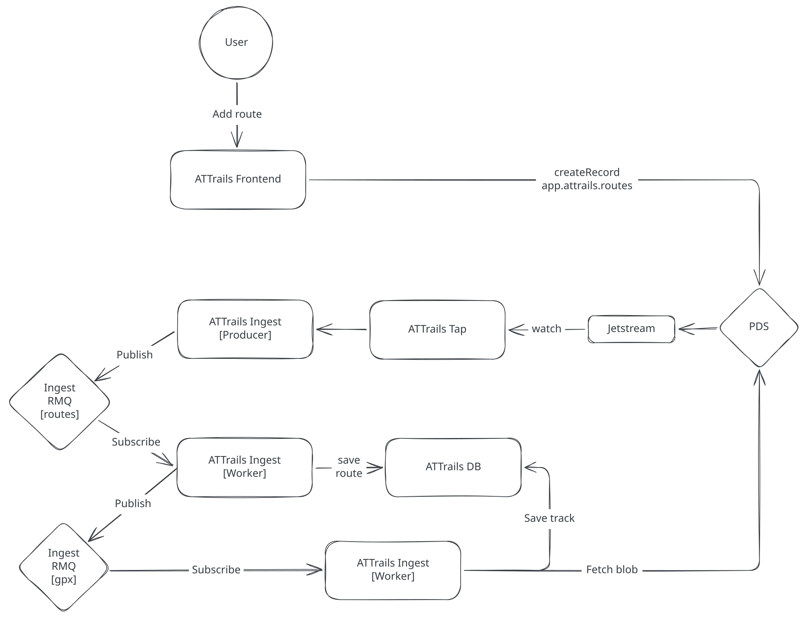

# ATTrails

ATTrails is an ATProto app for sharing cycling, running, and hiking routes. It helps you share your collection and discover routes uploaded by others.

## Features

- Share your routes as GPX files with the world
- Discover routes shared by others
- Review and curate your personal collection of favorite routes

## Web App

The ATTrails website is a Next.js based application. It uses modern React features including server actions, suspense, and cache components. It is deployed as a self-hosted Docker container.

The Next.js application is also the "backend" for the website, using server actions, API routes and server-side data fetching.

## Ingestion

The ingestion layer for ATTrails is built in Rust, fed by an ATProto [Tap](https://github.com/bluesky-social/indigo/blob/main/cmd/tap/README.md) instance.

### Crates

- `ingest-watcher`: Watches relevant collections from an ATProto [Tap](https://github.com/bluesky-social/indigo/blob/main/cmd/tap/README.md) instance and enqueues any new events for processing.
- `ingest-consumer`: Processes events produced by `ingest-watcher` to transform and index routes, reviews, profiles, and GPX files, and labels them for moderation.
- `lifecycle`: Shared liveness/readiness probes and graceful shutdown signal handling.
- `amqp`: Manages RabbitMQ connection and queues.
- `database`: Manages the Postgres connection pool and schema migrations.
- `lexicons`: Generated code for lexicons relevant to this app.
- `moderation`: Infers moderation labels for records using the Jev decisions API.
- `tracks`: Parses GPX files into track summaries, paths, and elevation profiles.

## Infrastructure

- Postgres + PostGIS for persistence
- RabbitMQ for messaging and job queues
- ATProto Tap for watching the Firehose
- Next.js web app for users
- [Jev](https://typesafe.ai) for moderation

## Local Development

Copy `.env.example` to `.env` and run `mise install` to get the toolchain.

`compose.yaml` runs Postgres (with PostGIS), RabbitMQ, and Tap. The `watcher` and `consumer` profiles add a containerised `ingest-watcher` or `ingest-consumer`, so the service being worked on can run with `cargo run` while compose provides the rest. Run `mise run db:migrate` once Postgres is up to create the schema.

`ingest-consumer` labels records with the [Jev decisions API](https://api.typesafe.ai), which needs an `ATTRAILS_DECISIONS_API_KEY`.

- `docker compose --profile consumer up`: Work on `ingest-watcher` (compose runs Postgres, RabbitMQ, Tap, and `ingest-consumer`)
- `docker compose --profile watcher up`: Work on `ingest-consumer` (compose runs Postgres, RabbitMQ, Tap, and `ingest-watcher`)
- `docker compose up`: Run only Postgres, RabbitMQ, and Tap
- `docker compose --profile watcher --profile consumer up`: Run everything in containers
- `docker compose --profile web up web`: Run the web frontend in a container on port 3000

Add `--build` to rebuild the service images after code changes.

## Migrations

Migrations live in `crates/database/migrations` and run with [sqlx-cli](https://github.com/launchbadge/sqlx/tree/main/sqlx-cli), installed via `mise install`. The target database is `ATTRAILS_POSTGRES_CONNECTION_URI` from `.env`.

- `mise run db:migrate:check`: List pending migrations without applying them
- `mise run db:migrate`: Apply pending migrations
- `sqlx migrate add <name>` (from `crates/database`): Create a new migration

Never edit a migration after it has been applied; add a new one instead.

## License

Licensed under either of

- Apache License, Version 2.0 ([LICENSE-APACHE](LICENSE-APACHE) or <https://www.apache.org/licenses/LICENSE-2.0>)
- MIT license ([LICENSE-MIT](LICENSE-MIT) or <https://opensource.org/licenses/MIT>)

at your option.

Unless you explicitly state otherwise, any contribution intentionally submitted for inclusion in this project by you, as defined in the Apache-2.0 license, shall be dual licensed as above, without any additional terms or conditions.
